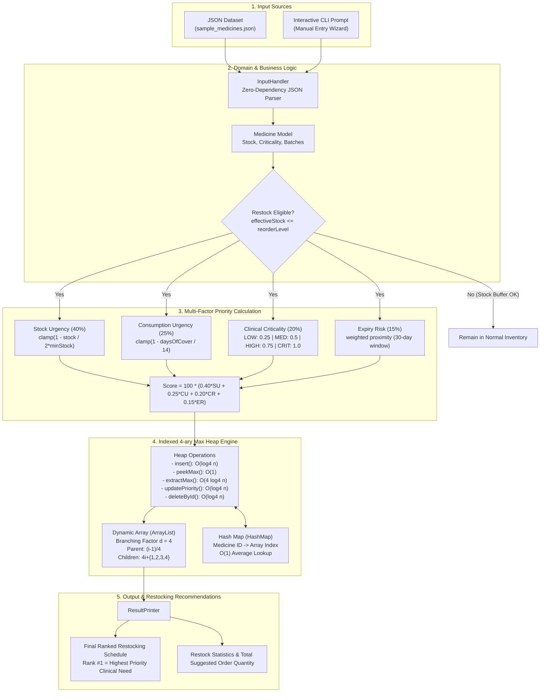

# SmartMed Priority Scheduling Engine Architecture



## 4-ary Max Heap Tree Hierarchy (Level Order)

```
                              [Root: Index 0]
                      /        |             |        \
            [Index 1]      [Index 2]     [Index 3]     [Index 4]
          /  |  |  \      /  |  |  \    /  |  |  \    /  |  |  \
         5   6  7   8    9  10 11  12  13 14 15  16  17 18 19  20
```

- **Height**: $\approx \log_4 n = \frac{\log_2 n}{2}$ (50% reduction in tree depth compared to binary heaps).
- **Cache Locality**: All 4 sibling children are stored contiguously in memory at indices $4i+1, 4i+2, 4i+3, 4i+4$, maximizing hardware cacheline prefetching.
- **Index Map Synchronization**: In every `swap(a, b)` operation, `map.put(id_a, b)` and `map.put(id_b, a)` execute simultaneously to guarantee bidirectional index consistency.
